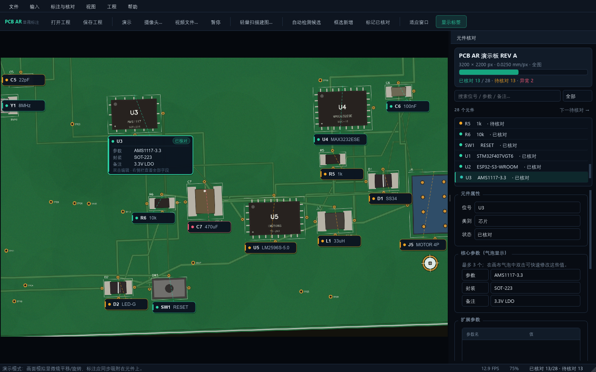
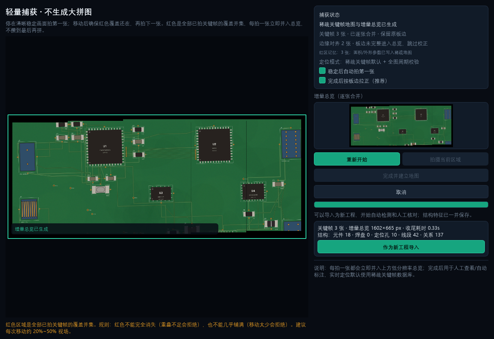
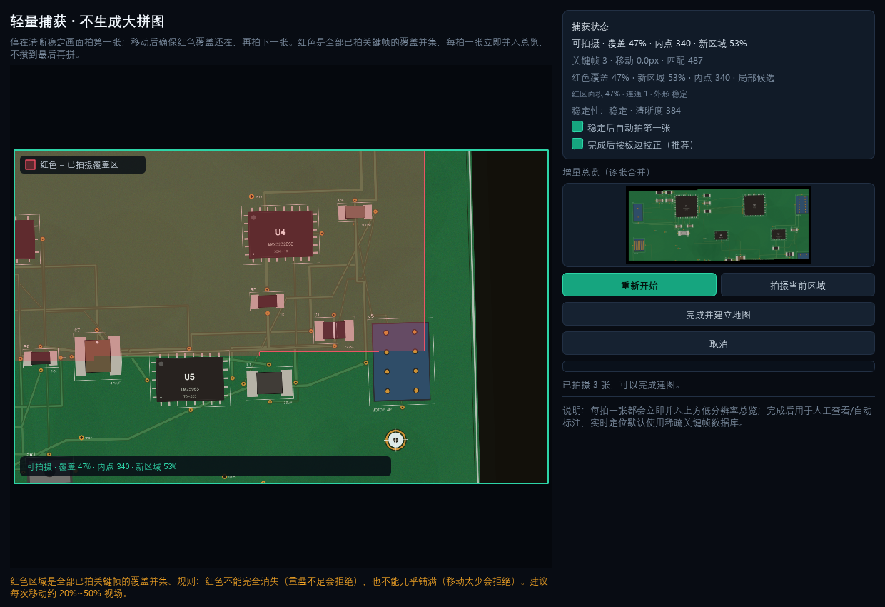

# PCB 显微 AR 标注核对系统

面向“摄像头固定在 PCB 正上方、显微镜手动平移/旋转”的桌面工具。默认流程已从“生成完整大拼图”改为 **轻量引导捕获 + 稀疏关键帧地图 + 全图周期校验**：只保存关键帧、ORB/边缘特征、位姿和覆盖区域；全图能力作为可选增强与备用。

> 版本：0.2.4（默认轻量建图；尚未经过真实 800 万像素显微硬件验收）
>
> 运行环境：Windows 10/11 x64 · Python 3.12（源码）· 便携版无需安装 Python
>
> 开源地址：<https://github.com/biekuaicom/obsai2026> · 许可证：GPL-3.0-only



## 1. 这个版本的核心变化

- **默认轻量扫描**：不再要求扫完整板后渲染一张大图。
  - 画面稳定、清晰时才允许拍摄；
  - 稳定后自动拍第一张；
  - 已拍区域用红色半透明覆盖跟随板面；
  - 移动后红色不能完全消失（重叠不足会拒绝），也不能几乎铺满（移动太少会拒绝）；
  - 每次只保存 1200px 关键帧、ORB 特征、位姿、覆盖多边形。
- **稀疏定位为默认**：实时画面先和少量关键帧做 ORB/RANSAC，恢复板坐标；不逐帧匹配整张大图。
- **每拍一张立即合并**：每次拍摄后立即把新关键帧 warp 进低分辨率总览，并扩展红色覆盖并集；右侧实时缩略图可立即检查接缝，不把全部关键帧攒到最后再拼。
- **边缘智能补偿**：合并前在重叠区用 Canny 板边/走线边缘做 ECC 小范围对齐；完成后可选按 PCB 外轮廓拉正，修正人工移动带来的旋转/轻微透视；背景不参与校正。
- **红区证据门控**：不再无条件相信旧关键帧的整帧矩形；旧 coverage 必须与当前帧重新匹配，并且匹配变换与历史位姿一致，否则不画红。UI 显示“已复核 N 张”，用来阻止整块假红。
- **红区面积/外形记忆**：每次拍摄记录红区面积、连通域、bbox、外形 Hu/IoU；与上次拍摄记忆比较，连续两帧异常就提示并禁止拍摄，防止整块假红被当成新覆盖。
- **结构特征树 B1**：整图完成后提取元件、焊盘、定位孔、长走线等稳定基元，保存尺寸/长宽比/方向和相对距离/角度关系图到 `structural_map.json`；为后续多组件结构匹配提供数据。


- **低分辨率总览 + 全图增强**：增量总览默认最大 3200px / 800 万像素，用于人工查看、自动标注和全图跟踪校验；不是几百 MB 的整板大图。
- **稀疏 + 全图混合跟踪**：默认使用稀疏结果；每隔若干帧用低分辨率总览做全图跟踪校验；稀疏失败或两者明显不一致时回退全图。
- **全图模式保留**：`输入 → 全图扫描（独立备用）` 仍可运行原来的完整视频扫描流程，用于对照或特殊场景；轻量工程的全图增强是自动的低分辨率总览周期校验。
- **工程坐标统一**：稀疏关键帧、总览图、元件框都在同一板坐标下；保存为 JSON + `sparse_map.json` + 特征 npz + keyframes。
- **原有能力保留**：自动候选、3 参数气泡、右侧完整参数、BOM 导入导出、人工核对、打包。



## 2. 快速开始

### 方式 A：打包版（推荐给现场）

1. 解压 `dist/PCB_AR_Annotator_v0.2.4_win64.zip`。
2. 双击 `PCB_AR_Annotator.exe`。
3. 首次启动自动生成演示工程；移动/旋转时标注应吸附在元件上。
4. 点击「轻量扫描建图…」体验新的默认流程；需要整图时用「输入 → 全图扫描（备用/增强）」。
5. 详见 [使用指南](docs/03_使用指南.md)。

> Windows SmartScreen 可能提示未知发布者（未签名）。选择“更多信息 → 仍要运行”。正式交付建议做代码签名。v0.2.4 本机包：onedir 约 218 MB，zip 约 86 MB。

### 方式 B：源码

```powershell
powershell -ExecutionPolicy Bypass -File .\scripts\setup_env.ps1
.\scripts\run.ps1
.\scripts\test.ps1
```

`setup_env.ps1` 只在项目内创建 `.venv`，不会写入系统 Python。为什么仓库不带 `.venv`、如何从零重建、依赖版本和常见问题见 [虚拟环境与依赖](docs/11_虚拟环境与依赖.md)。

## 3. 推荐现场流程

1. **输入**：摄像头/演示/视频文件。
2. **轻量建图**（默认）：
   - 点击「轻量扫描建图…」→「开始捕获」；
   - 停稳，系统自动拍第一张；
   - 移动电路板/视野，保留一部分红色覆盖；
   - 红色覆盖还在、画面稳定时点击「拍摄当前区域」；
   - 重复覆盖整板 →「完成并建立地图」；
   - 每拍一张都会立即并入右侧总览；全部拍完后「完成并建立地图」，收尾只整理稀疏地图。
   - 检查增量总览和红色并集，确认没有明显错位后作为新工程导入。
3. **自动候选**：自动检测候选 → 框选补漏。
4. **人工核对**：双击气泡改 3 个核心参数；右侧栏改全部字段、扩展参数和坐标。
5. **实时跟随**：回到实时画面；默认稀疏定位，周期全图校验。状态栏会显示“稀疏定位/全图增强”和内点数。
6. **保存/导出**：Ctrl+S；文件菜单导出 BOM CSV。

## 4. 轻量流程的工程逻辑

```text
稳定检查（清晰度 + 相位相关位移）
   ↓
首张关键帧（1200px + ORB + 位姿=原点 + 覆盖多边形）
   ↓
移动 → 当前帧与上一关键帧 ORB/RANSAC（失败再试更早已拍帧）
   ↓
当前位姿 = 上一关键帧位姿 × 帧间相似变换
   ↓
投影全部已拍覆盖多边形到当前画面（红色）
   ↓
重叠 10%~82% + 内点≥14 + 稳定 → 允许拍摄
   ↓
重复 → 关键帧位姿图 + 每个关键帧的覆盖/邻居
   ↓
每张立即 warp 进增量总览 + 扩展覆盖并集
   ↓
完成后只整理稀疏地图（不重新拼接）
```

实时定位：

```text
当前帧 ORB/边缘特征
   → 上一关键帧 + 全局边缘描述子 top-k 检索
   → 候选关键帧 ORB/RANSAC
   → 板坐标 -> 实时帧 相似变换
   → 与全图跟踪每 10 帧校验；失败/分歧时回退全图
```

## 5. 为什么不是“只存黑白线条”

黑白边缘图可以作为覆盖显示和粗筛，但**不能单独作为定位数据库**：

- PCB 上重复的焊盘、过孔、平行走线会让二值图出现大量相同局部图案；
- 反光/氧化/烧黑会改变阈值结果；
- 元件的阻值/容值无法从形状推出，参数必须来自 BOM/人工/OCR；
- 不同板型/版本必须重新建图。

本项目采用的实际折中：

- **匹配用 ORB 特征**（本身就是紧凑二值描述子）+ RANSAC 几何校验；
- **边缘描述子**用于关键帧粗检索；
- 关键帧只保留 1200px 压缩图/特征/位姿，不保留整张高分辨率拼图；
- 每拍一张立即生成/扩展低分辨率增量总览；
- 参数存 JSON/BOM，不由形状推断。

## 6. 工程结构

```text
src/pcb_ar/
  core/
    geo.py              # 仿射、BBox、平滑
    tracker.py          # 全图 ORB 跟踪
    sparse_map.py       # 关键帧/特征/位姿/稀疏地图持久化
    sparse_capture.py   # 稳定检查、覆盖、重叠校验、轻量建图
    sparse_localizer.py # 稀疏定位 + HybridTracker（全图校验/回退）
    board_rectify.py    # 板体外轮廓检测 + 单应拉正
    structural_map.py   # 元件/焊盘/定位孔/走线基元 + 相对关系图
    video_scan.py       # 原连续视频全图扫描（备用）
    stitcher.py         # 总览/散图渲染
    detector.py         # 候选检测 + 可选 YOLO
    project.py          # JSON 工程 + sparse/overview 资源
    bom.py / synthetic.py
  ui/
    guided_capture_dialog.py  # 默认轻量捕获工作台
    scan_dialog.py            # 全图扫描备用工作台
    main_window.py / overlay.py / sidebar.py / ...
  selftest.py
tests/                  # 36 项自动化测试
docs/                   # 架构/算法/使用/开发/打包/测试/虚拟环境
packaging/              # PyInstaller spec、图标、版本信息
scripts/                # 环境、运行、测试、打包、GitHub 同步
```

## 7. 测试与实测数据（本机）

| 项目 | 结果 |
|---|---|
| pytest | 36 passed |
| 轻量捕获 | 3 个关键帧逐张合并为增量总览；ECC 边缘对齐 0.1~0.3px；收尾约 0.02 s |
| 稀疏定位 | 合成板连续帧锁定，四角误差约 0.1~0.2 px（短序列） |
| 稀疏单帧耗时 | 约 50~60 ms（1600×1000 输入，工作宽 1200） |
| 混合跟踪 | 稀疏为主；每 10 帧全图校验，失败/分歧回退 |
| 全图扫描（备用） | 28 关键帧 2689×1203，约 3.2 s |
| 自动候选 | 合成板 23+ 个候选，需人工核对 |
| 打包后自检 | 13 项 PASS，约 10.2 s（见 `artifacts/packaged_selftest.json`） |

数据来自合成图与本机 CPU，不代表真实相机/显微镜的最终精度和帧率。详见 [测试报告](docs/08_测试报告.md)。

## 8. 已知边界与风险

- **未用真实 800W 相机/显微镜验收**；反光、景深、运动模糊、镜头畸变仍需现场测试。
- **轻量捕获依赖操作员**：必须停稳、保持红色重叠；快速移动会拒绝拍摄。
- **稀疏地图只有关键帧**：视场落在两个关键帧之间时，靠 ORB 相似变换插值；极端重复纹理可能误锁，依赖全图增强/人工确认。
- **仍有累积漂移/接缝错位**：每张立即合并、优先匹配多个旧关键帧、重叠区 ECC 边缘对齐，能减少局部错位；但当前没有回环闭合/位姿图优化，也不能把任意走线恢复成 CAD 直线。请用右侧增量总览逐张检查，长扫描分段补拍。
- **烧毁/换版**：同型号且几何/焊盘仍可定位时有机会匹配；不同版本请新建地图。参数无法只靠形状得到。
- **PyQt6 许可**：GPLv3/商业双许可；闭源商业分发前需购买商业许可或迁移 PySide6。见 [第三方说明](THIRD_PARTY_NOTICES.md)。
- **未代码签名**：SmartScreen 会提示。

## 9. 打包

```powershell
powershell -ExecutionPolicy Bypass -File .\scripts\build.ps1
```

产物：

- `dist/PCB_AR_Annotator/PCB_AR_Annotator.exe`
- `dist/PCB_AR_Annotator_v0.2.4_win64.zip`
- `artifacts/packaged_selftest.json`、`artifacts/packaged_demo.png`
- `dist/CHECKSUMS.txt`

打包后自检会在 offscreen 模式创建工程、跑跟踪、渲染界面、编辑参数并重新加载工程。

## 10. 文档索引

- [需求与总体架构](docs/01_需求与总体架构.md)
- [算法设计](docs/02_算法设计.md)
- [使用指南](docs/03_使用指南.md)
- [开发指南](docs/04_开发指南.md)
- [打包发布](docs/05_打包发布.md)
- [硬件集成与演进](docs/06_硬件集成与演进.md)
- [开源方案评估与选型](docs/07_开源方案评估与选型.md)
- [测试报告](docs/08_测试报告.md)
- [交付清单与验收](docs/09_交付清单.md)
- [轻量稀疏建图设计](docs/10_轻量稀疏建图设计.md)
- [虚拟环境与依赖](docs/11_虚拟环境与依赖.md)
- [结构特征树与覆盖可信度](docs/12_结构特征树与覆盖可信度.md)
- [第三方许可说明](THIRD_PARTY_NOTICES.md)
- [GPL-3.0 许可证](LICENSE)

## 11. 许可证

本项目采用 **GPL-3.0-only**。PyQt6 本身为 GPLv3/商业双许可；如果未来需要闭源商业分发，需要购买 PyQt 商业许可，或迁移到 LGPL 的 PySide6。详见 [第三方许可说明](THIRD_PARTY_NOTICES.md)。

## 12. 一键同步 GitHub

```powershell
$env:GITHUB_TOKEN = "<your-personal-access-token>"
powershell -ExecutionPolicy Bypass -File .\scripts\sync_github.ps1
```

脚本不会把 token 写入仓库或 git remote；默认创建/同步 `biekuaicom/obsai2026`，并输出仓库地址。
