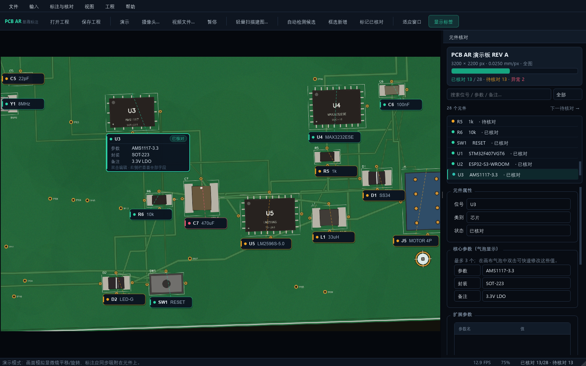
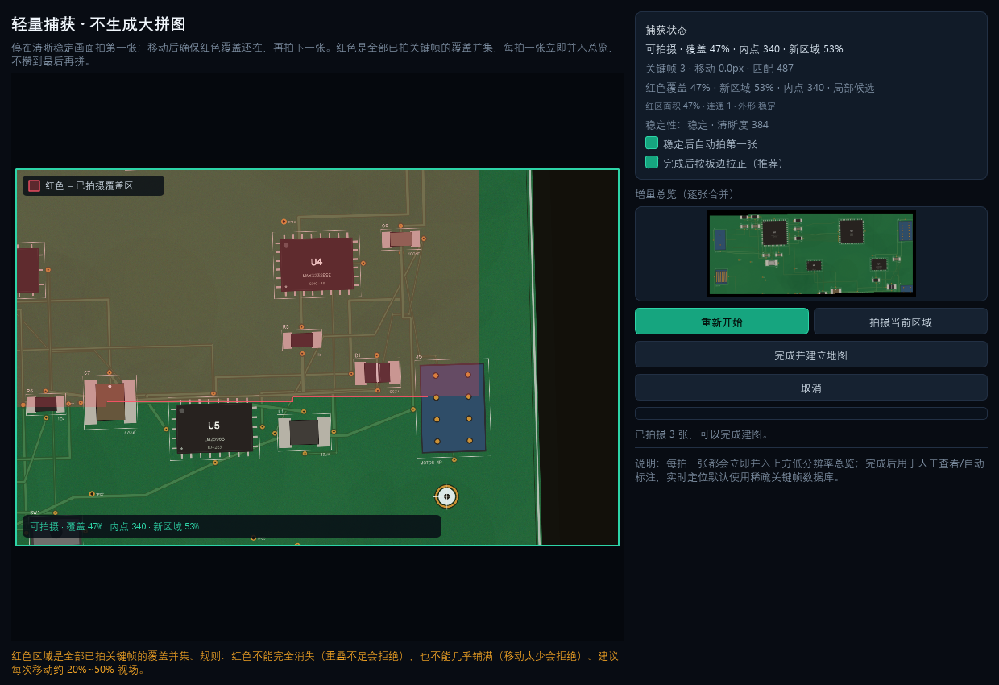
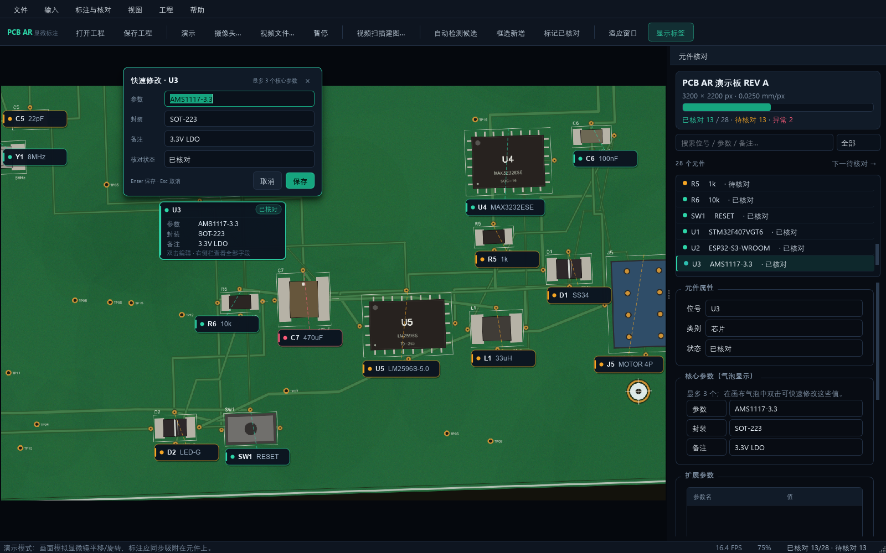

# 03 使用指南

## 1. 启动与界面

双击 `PCB_AR_Annotator.exe`。首次启动会：

1. 在 `%LOCALAPPDATA%\PCB_AR_Annotator\demo` 生成演示工程；
2. 自动播放模拟显微镜画面；
3. 显示 28 个演示元件、状态颜色和参数气泡。

界面分区：

- **顶部工具栏**：打开/保存、演示/摄像头/视频、轻量扫描建图、自动检测、框选新增、核对、适应窗口、标签开关。全图扫描在「输入」菜单中作为独立备用。
- **中央画布**：实时画面 + AR 标注。滚轮缩放；空白处左键拖动平移；双击元件气泡编辑。
- **右侧栏**：工程统计、搜索/筛选、元件列表、完整参数、扩展字段、坐标、备注和核对按钮。
- **底部状态栏**：输入源、跟踪状态（内点/置信度/耗时）、FPS、缩放比例、核对进度。



## 2. 三种输入方式

### 2.1 演示（无硬件）

点击「演示」。画面由合成 PCB 连续平移/旋转生成，用于：

- 验证标注是否会跟着元件移动；
- 演示轻量捕获和实时跟随流程；
- 培训/验收 UI。

演示工程和真实工程一样可保存、编辑、导出 BOM。

### 2.2 USB / HDMI 采集摄像头

点击「摄像头…」，输入摄像头索引（通常为 0；多摄像头可试 1、2），确定。

- 程序优先尝试 DirectShow，失败后尝试 Media Foundation/默认后端。
- 在摄像头驱动/采集软件中预先设置好分辨率、曝光、增益；本版不提供相机参数面板。
- 800 万像素相机通常以 4K 输出；程序会降采样到 1600 宽用于显示，1200 宽用于跟踪，避免实时性下降。
- 如果打开失败，关闭占用摄像头的其他软件（相机厂商工具、Zoom、OBS 等）。

### 2.3 视频文件

点击「视频文件…」，选择录制好的显微镜视频。视频默认循环播放。适合离线演示和算法调参。

> 暂停按钮（F5）只停止取帧；恢复后继续从当前位置读取。

## 3. 默认建图：轻量捕获

前提：已有实时画面（演示/摄像头/视频均可）。



### 3.1 操作步骤

1. 点击工具栏「轻量扫描建图…」。
2. 点击「开始捕获」。
3. 停稳、保持清晰。系统连续判断：
   - Laplacian 清晰度；
   - 帧间位移（相位相关）。
4. 稳定后（默认 2 帧，约 0.3 s）自动拍第一张。也可取消“自动拍第一张”，手动点「拍摄当前区域」。
5. 移动电路板/视野，**保留一部分红色覆盖**：
   - 红色 = **全部已拍关键帧的覆盖并集**，会跟随板面移动；
   - 红色完全消失 = 重叠不足，拒绝拍照，请回退；
   - 红色几乎铺满 = 移动太少，拒绝拍照，请移到新区域；
   - 建议每次移动约 20%~50% 视场。
6. 停稳，红色覆盖在 10%~82% 且内点足够时，点击「拍摄当前区域」。
7. 每拍一张，右侧「增量总览」立即更新；检查新区域接缝是否吻合，发现错位立即补拍/回退。
8. 重复，直到覆盖整块板。工作台显示关键帧数和当前覆盖。
9. 点击「完成并建立地图」；此时只整理稀疏地图，不再重新拼全部图，通常几十毫秒。
10. 完成后默认会按板体外轮廓拉正；如果板边没有完整进入总览会自动跳过。可取消“完成后按板边拉正（推荐）”。
11. 检查最终增量总览和“边缘对齐 N 张”的提示，点击「作为新工程导入」，填写名称和保存位置。

导入后建议：

- 打开「工程」→「工程信息 / 比例标定…」，设置 `mm/px`。
- 先执行自动检测候选，或手动框选标注，再进行核对。
- 增量总览用于人工查看/自动标注/全图校验；实时定位默认用稀疏关键帧。
- 每张合并前会做重叠区 ECC 边缘对齐；完成后可再按板边拉正，主要修正板边/走线边缘的刚性错位。
- 完成建图后会自动提取结构基元（元件/焊盘/定位孔/长走线）并保存 `structural_map.json`，并用代表关键帧做一次结构图匹配校验；当前版本不改变人工核对流程。
- 结果栏和「文件」菜单都有「导出整张图…」，可保存 PNG/JPEG。
- 如果扫描回到已拍区域，完成时会建立回环边并做一次位姿图优化，再用优化位姿重渲染总览；长扫描仍建议分段并检查接缝。
- 拍摄时会在红色重叠区核对边缘和灰度内容；状态栏会显示“重叠内容核对 xx%”，低于预期时建议重拍。

### 3.2 红色覆盖规则

| 现象 | 含义 | 操作 |
|---|---|---|
| 红色 >=10% 且 <=82%，稳定 | 与全部已拍并集有重叠、移动足够 | 可以拍 |
| 红色 <10% | 与已拍并集重叠不足 | 回退，让红色重新出现 |
| 红色 >82% | 移动太少，重复信息多 | 移动到新的板区域 |
| 红色完全消失/提示无匹配 | 位置关系丢失 | 回退到上一张附近，放慢移动 |
| “画面未稳定” | 手抖/运动模糊 | 停稳 0.3~0.5 秒 |

红色只是提示；程序正常只匹配上一张 + 最近 4 张，局部全部失败才回退全局候选；红区由板级 coverage mask warp 得到，只包含实际非黑像素，不再随关键帧数量做路径并集。

另外，程序会记住上次拍摄的红区面积/外形，并与当前红区比较；面积突增、外形突变、红区碎裂连续两帧会提示“红区面积/外形异常”并暂时禁止拍摄。看到这个提示请回退到上一张附近，稳定两帧再拍。

### 3.3 全图扫描（独立备用）

菜单「输入 → 全图扫描（独立备用）…」仍保留原连续视频扫描：

- 连续移动覆盖板面，生成整张低分辨率/全图总览；
- 适合对照、离线留档，或轻量模式效果不理想时使用；
- 28 个关键帧约 3.2 秒；
- 作为独立工程创建，不走稀疏地图。

轻量工程本身会自动生成本低分辨率总览，实时跟踪默认稀疏定位、每 10 帧用全图校验；因此“全图增强”在轻量工程中已经生效，无需再扫一遍整图。

### 3.4 散图备用

全图扫描工作台下方「导入多张重叠照片拼接…」：

- 选择按拍摄顺序排列、有 25% 左右重叠的图片；
- 使用 SIFT + 内容相关性校验；
- 失败时会提示哪一张无法配准。

散图模式对顺序和重叠更敏感，只建议在无法重扫时使用。

## 4. 标注与核对

### 4.1 自动检测候选

点击「自动检测候选」：

- 在低分辨率总览图上检测“非板材、成块”的区域；
- 追加为 `X1、X2…` 的“候选元件”，全部为待核对；
- 不会删除已有标注，也不会自动给出正确位号/类别。

检测结果通常包含少量过检/粘连，必须人工修正。

### 4.2 框选补漏

1. 点击「框选新增」（快捷键 Ctrl+Shift+A）。
2. 在画面上拖出矩形框，松开。
3. 自动创建 `X#` 待核对元件，并选中、打开右侧栏。
4. 修改位号/类别/参数，点击「应用修改」。
5. 如果当前是实时画面但跟踪未锁定，程序会拒绝创建，因为无法把屏幕框反算回全局坐标。

### 4.3 画布内联编辑（最多 3 个核心参数）

- 单击元件框或气泡：选中，气泡展开。
- 再次单击已选中的气泡，或双击气泡：弹出「快速修改」浮层。
- 可修改：
  - 3 个核心参数的值；
  - 核对状态。
- Enter 保存；Esc 取消。
- 核心参数的**名称**在右侧栏修改；气泡只显示值。
- 设计约束：画布内联只放 3 个参数，避免遮挡元件；更多字段在右侧栏。



### 4.4 右侧栏完整参数

- 位号：必须唯一；重复会拒绝应用。
- 类别：可下拉选择或手动输入。
- 状态：待核对/已核对/异常。
- 核心参数：3 行，名称 + 值；名称会显示在气泡中。
- 扩展参数：任意键值对，支持添加/删除选中行；重复键会被拒绝。
- 位置与尺寸：总览图像素坐标（板坐标）；修改后框立即移动。
- 备注：供应商、批次、工艺注意事项等。
- 「应用修改」保存表单；「标记已核对/异常」会**先应用表单**再改状态，避免修改丢失。

### 4.5 核对工作流

1. 使用搜索/状态筛选定位元件；
2. 修正框位置（坐标）和参数；
3. 点击「标记已核对」；
4. 点击「下一待核对 →」继续；
5. 完成后保存（Ctrl+S）。

颜色：

- 琥珀色：待核对；
- 绿色：已核对；
- 红色：异常。

## 5. BOM / 元件清单

### 5.1 导入

支持 CSV，自动识别：

- UTF-8 / UTF-8 BOM / GB18030/GBK；
- 逗号、分号、Tab；
- 中文或英文表头。

最少需要位号列，支持别名：

| 字段 | 支持表头 |
|---|---|
| 位号 | 位号、RefDes、Designator、Reference、Ref |
| 参数 | 参数、值、Value、Comment |
| 封装 | 封装、Package、Footprint |
| 类别 | 类别、类型、Category、Type |
| 备注 | 备注、说明、Notes、Description |

其他列会写入扩展参数。匹配按位号（不区分大小写）；未匹配行和 BOM 缺失的已标注元件会在结果中列出。

### 5.2 导出

「文件 → 导出 BOM / CSV…」输出 UTF-8 BOM 的 CSV，可直接用 Excel 打开。包含位号、类别、核心参数、备注、状态以及所有出现过的扩展字段。

## 6. 工程管理

- **新建工程**：选择一张完整板图（正视、无畸变），填写名称，保存为 `.pcbproj.json`。这是全图模式，和轻量工程兼容。
- **打开工程**：选择 `.pcbproj.json`；总览图、稀疏地图和关键帧都在同目录的 `*_assets/` 下。
- **保存/另存为**：Ctrl+S / Ctrl+Shift+S。保存前会写 `.bak`；另存为会整体复制 assets（含稀疏地图与关键帧）。
- **工程信息**：修改名称、`mm_per_px`、备注。`mm/px` 只影响显示和未来机台换算，不影响像素跟踪。
- **关闭**：如有未保存修改，会提示保存/放弃/取消。

工程目录示例：

```text
我的板子.pcbproj.json
我的板子_assets/
  global_board.png        # 低分辨率总览（轻量工程）
  sparse_map.json         # 关键帧位姿/覆盖/邻居
  sparse_features.npz     # ORB 关键点/描述子
  keyframes/
    kf_0000.jpg
    kf_0001.jpg
    ...
```

整个目录可拷贝到其他电脑；不要只拷 JSON。

## 7. 快捷键

| 快捷键 | 功能 |
|---|---|
| Ctrl+O / Ctrl+S / Ctrl+Shift+S | 打开 / 保存 / 另存 |
| Ctrl+D | 演示 |
| Ctrl+K | 摄像头 |
| F5 | 暂停/继续 |
| Ctrl+M | 轻量扫描建图（默认） |
| Ctrl+Shift+M | 全图扫描（独立备用） |
| Ctrl+G | 自动检测候选 |
| Ctrl+Shift+A | 框选新增 |
| Ctrl+E | 快速编辑选中元件 |
| F2 | 显示/隐藏覆盖层 |
| F3 | 显示/隐藏标签 |
| F4 | 全部展开参数 |
| Ctrl+Enter | 标记已核对 |
| Ctrl+Shift+I | 标记异常 |
| Ctrl+Shift+Delete | 删除选中 |
| Ctrl+Shift+N | 下一待核对 |
| Ctrl+0 / Ctrl+1 | 适应窗口 / 100% |
| Ctrl+= / Ctrl+- | 放大 / 缩小 |
| F1 | 快捷键与流程 |

## 8. 数据位置与隐私

| 内容 | 路径 |
|---|---|
| 应用配置 | `%LOCALAPPDATA%\PCB_AR_Annotator\config.json` |
| 演示工程 | `%LOCALAPPDATA%\PCB_AR_Annotator\demo\` |
| 日志 | `%LOCALAPPDATA%\PCB_AR_Annotator\logs\app.log` |
| 用户工程 | 用户选择的位置 |

所有图像处理在本机完成，不上传网络。

## 9. 常见问题

| 现象 | 可能原因 | 处理 |
|---|---|---|
| 摄像头打不开 | 被占用/驱动/索引不对 | 关闭占用程序；试索引 1；用系统相机应用确认 |
| 画面很卡 | 4K 输入 + 高特征数 | 降低相机分辨率/曝光；调低 `config.json` 中的特征数和显示宽度 |
| 框和元件错位 | 跟踪未锁定/总览或稀疏地图质量差/框坐标错 | 看状态栏内点；重新捕获；用侧栏坐标修正框 |
| 跟踪频繁变黄 | 纹理不足/反光/移动快 | 让视场包含丝印/定位孔；调光；放慢移动 |
| 轻量捕获红色消失 | 移动太快/无重叠/特征不足 | 回退让红色重新出现；放慢；对准丝印/定位孔 |
| 轻量捕获红色 >82% | 移动太少 | 移动到新的板区域再拍 |
| 轻量捕获一直“未稳定” | 手抖/运动模糊/曝光变化 | 停稳 0.3~0.5s；缩短曝光；调光 |
| 稀疏定位误锁 | 重复焊盘/走线 | 保留定位孔/连接器在视场；全图校验会纠正；必要时全图扫描 |
| 全图扫描提示重叠不足 | 移动太快/画面模糊 | 回退一点，放慢，保持 80% 重叠 |
| 整图接缝错位 | 累积漂移/重复纹理 | 分段重扫；减少快速旋转；每张看右侧增量总览；后续版本将加回环闭合 |
| 板边拉正被跳过 | 板边贴到画面边缘/颜色掩膜不足 | 让整块板（含少量黑边）进入总览；或取消“完成后按板边拉正” |
| 中文显示为方框 | 系统缺少中文字体/远程桌面字体 | 安装微软雅黑；正常 Windows 桌面一般自带 |
| 打包版启动慢/被杀软拦截 | 未签名 PyInstaller 包 | 添加信任；正式发布做代码签名 |
| 关闭时卡住 | 相机读取阻塞 | 等待几秒；强退后重新启动；检查采集驱动 |

## 10. 现场验收建议

1. 用真实 800W 相机在最高工作分辨率下录 2 分钟视频；
2. 用轻量捕获按 20%~50% 视场步进拍 10~20 张，检查红色覆盖与重叠拒绝是否可靠；
3. 建立轻量工程，检查总览/关键帧/稀疏地图文件齐全；
4. 在视场四角/中心检查 10 个已知元件框的稳定性，记录最大漂移（px 和 mm）；
5. 断开/遮挡 1 秒，观察稀疏定位是否能重捕、全图校验是否回退；
6. 用 BOM 导入 100 行，核对匹配率；
7. 保存/重开/换机器验证工程可移植性；另存为后确认 keyframes 被复制。

---

下一步：[打包发布](05_打包发布.md) · [硬件集成](06_硬件集成与演进.md) · [测试报告](08_测试报告.md)
